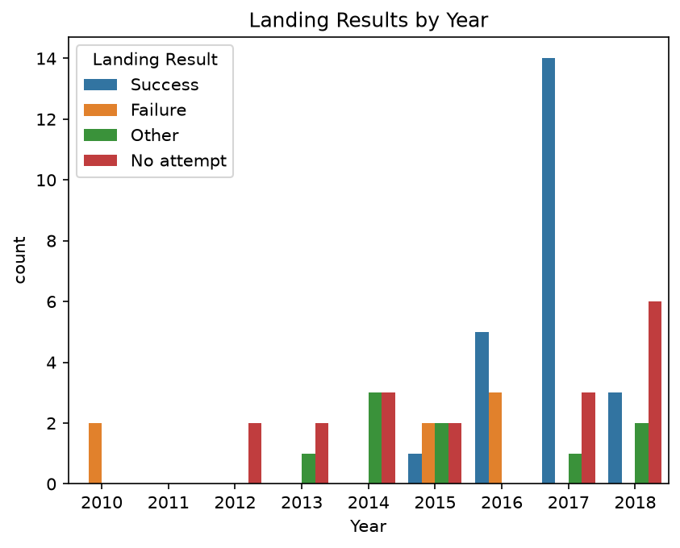
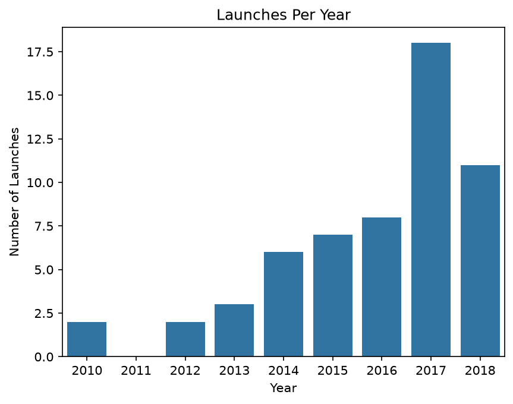
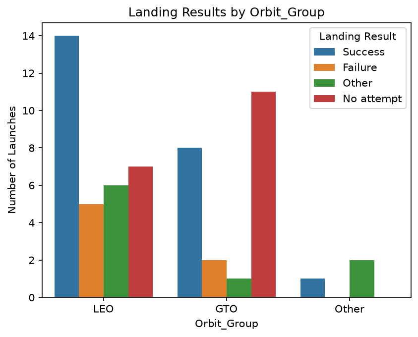

# SpaceX Booster Landings, 2010 to 2018

*Did SpaceX get better at landing its rockets, and does the type of mission matter?*

## The short version
- Successful landings began in 2015 and grew quickly. By 2017, SpaceX landed 14 boosters without a single failure.
- SpaceX launched far more often over time, from 2 launches in 2010 to 18 in 2017.
- Orbit seems to affect whether SpaceX *tried* to land a booster, but not clearly whether the landing worked.

## Why this question?
SpaceX is known for landing the first stage of its rockets (the "booster") so it can be reused. This project looks at 57 launches between June 2010 and June 2018 to see how landing results changed over time and whether the kind of mission made a difference.

## Key findings

### 1. Landings became much more successful from 2015

The first successful landing came in 2015. After that, successes grew: 5 in 2016 and 14 in 2017, with no failures in 2017. Early on (2010 to 2014), the landing attempts were mostly tests that ended in failure or in ocean landings.

### 2. SpaceX launched much more often

Launches grew from 2 in 2010 to 18 in 2017. There were no launches in 2011, and 2018 only covers the first part of the year (the data ends in June 2018).

### 3. Orbit relates to whether SpaceX tried to land

- **LEO** (low Earth orbit, for example trips to the International Space Station): only 7 of 32 launches had no landing attempt.
- **GTO** (geostationary transfer orbit, a high orbit used for communications satellites): 11 of 22 launches had no landing attempt.
- Among launches with a clear success or failure, success rates were similar (about 74% for LEO and 80% for GTO), but the numbers are small.
- Launches with no landing attempt also tended to carry the heaviest payloads. This fits the idea that very heavy missions leave less capacity for a landing, but the data cannot prove that.

## Things to keep in mind
- Only 57 launches, and just 39 of them tried a landing, so results are indicative and not firm.
- 4 launches have no recorded payload mass.
- 2018 is a partial year, and 2010 to 2013 have very few launches.
- Correlation is not cause: for example, payloads got heavier over time (correlation about 0.44), but this does not show why.

## About the data
- Source: [SpaceX Launch Data](https://www.kaggle.com/datasets/scoleman/spacex-launch-data) on Kaggle. License: CC BY-SA 3.0.
- Main file used: Data/spacex_launch_data.csv. Data/spacex_missions.csv is included but not used.

## What I did
1. Loaded and checked the data (one row per launch, 57 launches, 11 columns).
2. Cleaned it: fixed dates and numbers, fixed inconsistent spacing in labels, and grouped landing outcomes and orbits.
3. Explored it with summary statistics and charts.
4. Wrote up the findings above.

## Files
- AI Foundations Project.ipynb: the full analysis, with notes
- Data/: the CSV files
- images/: the charts used in this README

## How to run it
Open the notebook in Jupyter and run all cells. It needs Python with pandas, matplotlib, seaborn and scipy.

## Author
Sai Harsha Teja